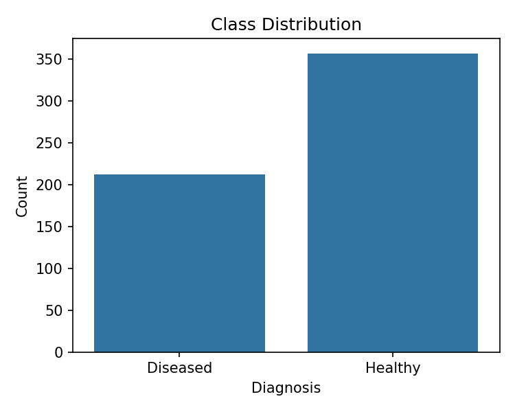
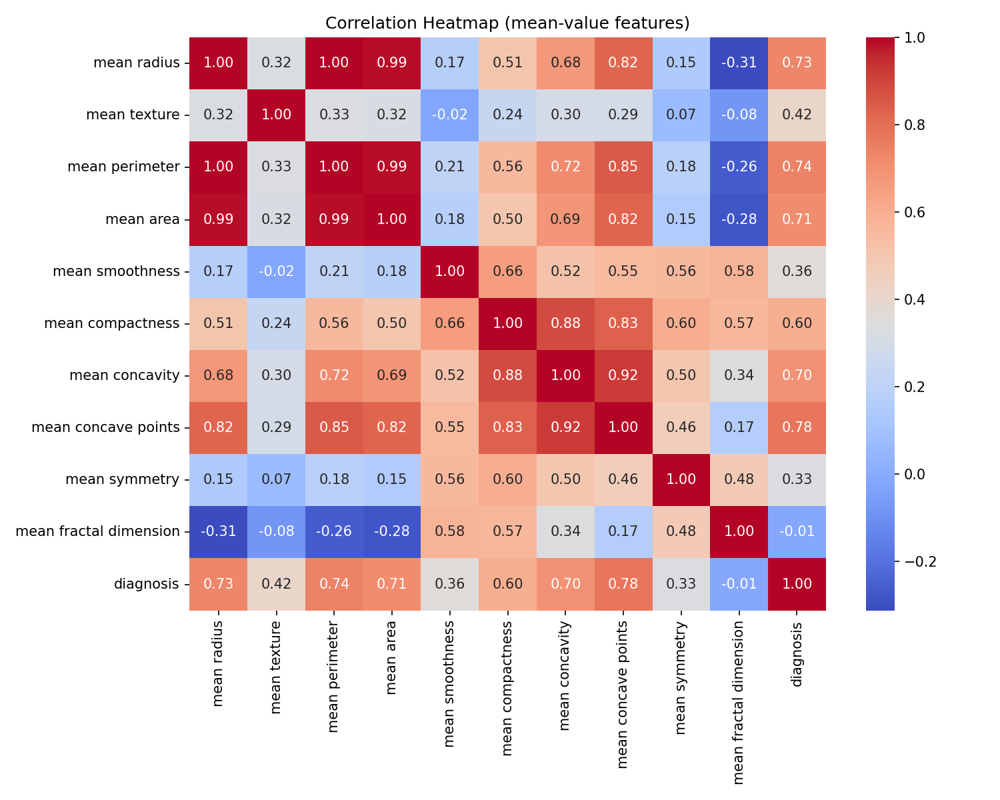
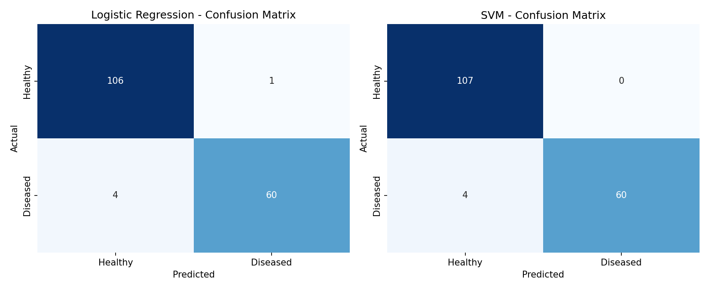
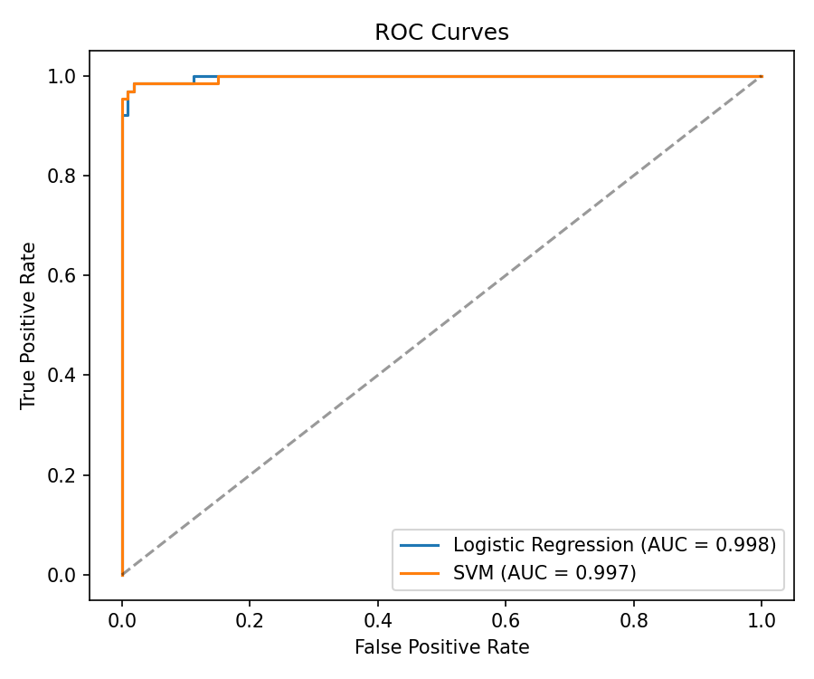
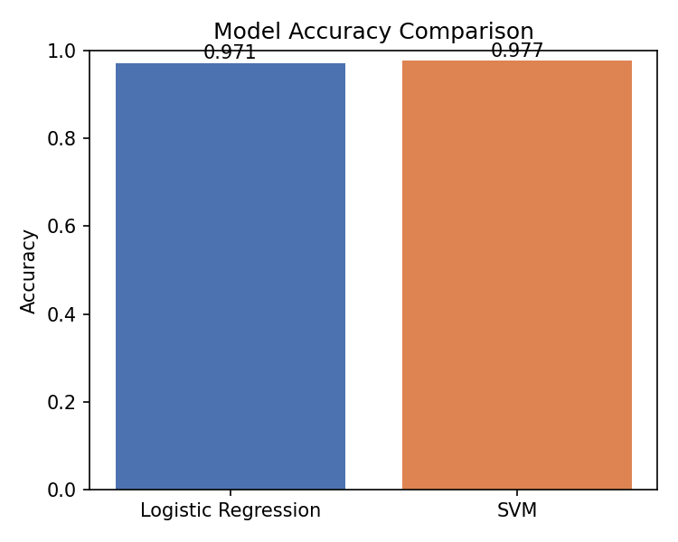
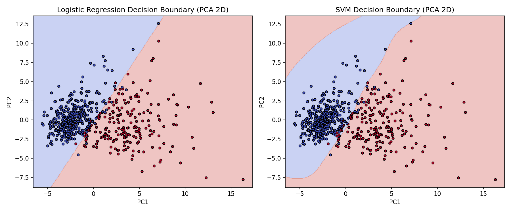

# 🩺 Disease Classification — Logistic Regression vs SVM

A binary classification project that predicts whether a breast tumor is
**benign (healthy)** or **malignant (diseased)** from diagnostic
measurements, comparing two classic classifiers on the same data.

Built with Python, pandas and scikit-learn.

---

## 📌 Overview

This is the classic **Breast Cancer Wisconsin (Diagnostic)** dataset. Given
30 numeric measurements taken from a tumor biopsy (size, texture, shape
regularity, etc.), the goal is to classify it as healthy or diseased —
and to compare a linear model (Logistic Regression) against a non-linear
one (SVM with an RBF kernel) on the same features.

---

## 📊 Dataset (`breast_cancer_dataset.csv.xlsx`)

- **569 samples**, 30 numeric features + 1 target column
- **Target:** `diagnosis` — `0 = Healthy (Benign)`, `1 = Diseased (Malignant)`
- **Class balance:** 357 healthy vs 212 diseased (63% / 37%)
- **Data quality:** no missing values, no duplicate rows

Each of the 10 base measurements (`radius`, `texture`, `perimeter`, `area`,
`smoothness`, `compactness`, `concavity`, `concave points`, `symmetry`,
`fractal dimension`) appears three times — as `mean`, `error` (standard
error), and `worst` (largest value) — giving 30 features total.

---

## ⚙️ Method

1. **Exploration** — shape, feature list, class balance, missing-value check,
   descriptive statistics.
2. **Preprocessing** — 70/30 train/test split with `stratify=y` to preserve
   the class ratio in both sets, then `StandardScaler` fitted on the
   training set only.
3. **Models**
   - `LogisticRegression(max_iter=5000)`
   - `SVC(kernel="rbf")` wrapped in `CalibratedClassifierCV` so it exposes
     calibrated `predict_proba()` — `SVC(probability=True)` is deprecated
     as of scikit-learn 1.9.
4. **Evaluation** — accuracy, precision/recall/F1 per class, confusion
   matrix, ROC curve with AUC.
5. **New-patient prediction** — both models score a raw 30-value
   measurement vector and report a diseased-probability.
6. **Visualization** — 6 charts saved to `outputs/`, including a 2D
   decision-boundary plot built from a PCA projection (illustrative only —
   the models themselves are trained on all 30 features, not the 2D
   projection, except in this one plot).

---

## 📈 Results

| Model | Accuracy | Precision (Diseased) | Recall (Diseased) | F1 (Diseased) |
|---|---|---|---|---|
| Logistic Regression | 0.9708 | 0.98 | 0.94 | 0.96 |
| **SVM (RBF, calibrated)** | **0.9766** | 1.00 | 0.94 | 0.97 |

### What the numbers say

- Both models score **above 97% accuracy** — this dataset is close to
  linearly separable once standardized, so both a linear model and a
  non-linear one do well.
- **SVM edges out Logistic Regression** here, and its precision on the
  diseased class is perfect (1.00) in this split — no healthy patient was
  misclassified as diseased. Recall is identical for both models (0.94):
  6 of 64 diseased cases were missed in this split.
- **For a real clinical deployment, Logistic Regression is still the
  recommended default**, even though SVM scored slightly higher here:
  1. Its coefficients are directly interpretable — a clinician can see
     which measurement drove a prediction.
  2. It is easier to validate, audit, and explain to regulators and
     patients, which matters for medical/legal accountability.
  3. It is computationally cheaper and does not need probability
     calibration.

     SVM is a strong secondary check when the goal is squeezing out a bit
     more raw accuracy and interpretability is not required.

### Charts

| | |
|---|---|
|  |  |
| Class balance (357 healthy / 212 diseased) | Correlation between mean-value features |

| | |
|---|---|
|  |  |
| Confusion matrix, both models | ROC curve with AUC, both models |

| | |
|---|---|
|  |  |
| Accuracy side by side | Decision boundary on a 2D PCA projection |

---

## 🚀 Run it

```bash
git clone https://github.com/M07-09/Disease_Classification_LogReg_SVM.git
cd Disease_Classification_LogReg_SVM
pip install -r requirements.txt
python disease_classification.py
```

The script prints the full analysis to the console and writes six charts
into `outputs/`.

**Requirements:** Python 3.8+ — see [`requirements.txt`](requirements.txt).

---

## ⚠️ Limitations

- **Small test set.** Only 171 samples in the test split; a single
  misclassified case moves accuracy by about 0.6 percentage points, so the
  reported numbers have real uncertainty around them.
- **The 2D decision-boundary plot is illustrative, not diagnostic.** It
  refits both models on a 2-component PCA projection purely to make a
  boundary visualizable — the actual evaluated models use all 30 features.
- **No probability threshold tuning.** Both models use the default 0.5
  cutoff. In a real screening context you would likely lower the threshold
  to trade some precision for higher recall on the diseased class, since
  missing a malignant case is far costlier than a false alarm.

---

## 📂 Structure

```
Disease_Classification_LogReg_SVM/
├── disease_classification.py       # full pipeline
├── breast_cancer_dataset.csv.xlsx  # Breast Cancer Wisconsin (Diagnostic)
├── requirements.txt
├── outputs/                        # generated charts
├── LICENSE
└── README.md
```

---

## 📄 License

[MIT](LICENSE) — free to use, modify and share.
